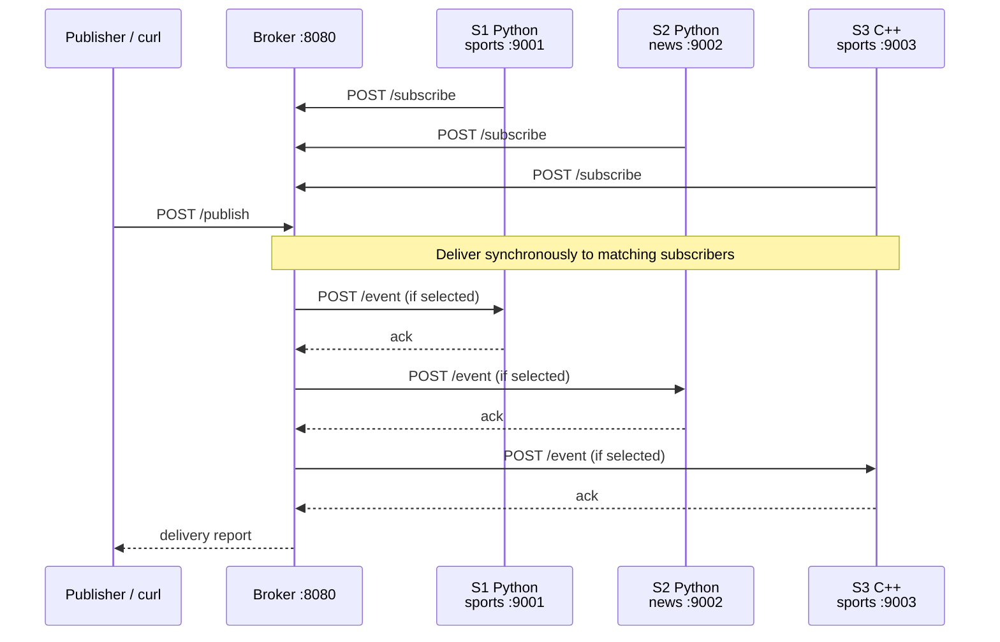

# Pub/Sub Demo

A small publish/subscribe system: one HTTP broker and three subscribers. The
broker delivers events to subscribers by topic, retries failed deliveries, marks
a subscriber DEAD after repeated failures, and recovers it when it re-registers.

The spec is `docs/spec.md`. This README explains how to build, run, and watch the demo.

## Architecture



- The broker is C++ (`broker/`), built with CMake. It uses cpp-httplib and nlohmann/json, vendored in `third_party/`.
- Subscriber S3 is C++ (`subscribers/` via the same build). S1 and S2 are Python (`subscribers/subscriber.py`), using only the standard library.
- Delivery is synchronous. The broker posts to each subscriber and waits for an ack before reporting.

## Delivery and failure rules

- A subscriber acks with `processed` on first sight of an `event_id`, and `duplicate` on repeats. Duplicates are ignored, not reprocessed.
- A failed delivery is retried until 3 attempts are used. After that the broker logs `MARK DEAD <id>`, and the subscriber is DEAD. DEAD subscribers are skipped until they re-register.
- Re-registering (`POST /subscribe`) sets the subscriber ALIVE and resets its failure count to 0.
- `DELETE /subscribe/<id>` removes the subscriber from the registry. The subscriber process is not stopped.

## Prerequisites

- Linux, or a Linux environment on Windows or macOS as described below.
- `g++` with C++17 support, CMake 3.16 or newer, Python 3, tmux, and curl.

On Debian or Ubuntu:

```bash
sudo apt install g++ cmake python3 tmux curl
```

### Windows

Native Windows builds are not supported: the C++ code uses POSIX signal and
time APIs, and the demo scripts require Bash and tmux. Use
[WSL 2 with Ubuntu](https://learn.microsoft.com/windows/wsl/install):

1. In an administrator PowerShell, run `wsl --install -d Ubuntu` and restart
   Windows if prompted. Complete Ubuntu's first-run account setup.
2. Open Ubuntu, clone this repository into its Linux filesystem, and `cd` into
   the clone. Install the Debian/Ubuntu prerequisites above.
3. Run `./scripts/run_all.sh`, then run `./scripts/demo.sh` in the publisher
   pane. All commands and curl examples below run inside Ubuntu.

### macOS

Native macOS builds are not currently supported: the C++ subscriber uses
`sigtimedwait`, which macOS does not provide. Run the Linux version with
[Docker Desktop for Mac](https://docs.docker.com/desktop/setup/install/mac-install/)
instead:

1. Start Docker Desktop. In Terminal, `cd` to a fresh clone of this repository.
   Remove or move any existing `build` directory from a different machine or
   operating system before building; CMake caches absolute paths.
2. Start an interactive Ubuntu container with the repository mounted:

   ```bash
   docker run --rm -it -v "$PWD:/workspace" -w /workspace ubuntu:24.04 bash
   ```

3. Inside the container, install the prerequisites and start the demo:

   ```bash
   apt update && apt install -y g++ cmake python3 tmux curl
   ./scripts/run_all.sh
   ```

4. In the publisher pane, run `./scripts/demo.sh`. Run the commands and curl
   examples below inside the container. To stop, run `tmux kill-session -t pubsub`
   and then `exit` the container. The container is removed on exit; installed
   packages do not persist, but files in the mounted repository do.

The container runs as root, so generated files in the mounted clone may be
owned by root. Ports are not published to the macOS host; use curl inside the
container.

## Build

```bash
cmake -S . -B build
cmake --build build -j
```

The binaries are `build/broker` and `build/subscriber`.

## Run

One command builds the project, starts every process in its own tmux pane, and
attaches to the session:

```bash
./scripts/run_all.sh
```

| Pane | Process | Port | Topics |
|------|---------|------|--------|
| broker | `build/broker --port 8080` | 8080 | — |
| S1 | `python3 subscribers/subscriber.py --id S1 --port 9001 --topics sports` | 9001 | sports |
| S2 | `python3 subscribers/subscriber.py --id S2 --port 9002 --topics news` | 9002 | news |
| S3 | `build/subscriber --id S3 --port 9003 --topics sports` | 9003 | sports |
| publisher | shell for running the demo | — | — |

Environment variables for `run_all.sh`:

- `PUBSUB_SESSION` — tmux session name (default `pubsub`).
- `SKIP_BUILD=1` — skip the configure and build step and use existing binaries.

`run_all.sh` replaces an existing session with the same name, so every run starts
with fresh registrations and fresh logs.

Each pane's output is also written to a log file, `${TMPDIR:-/tmp}/<session>-logs/<role>.log`
(for example `/tmp/pubsub-logs/broker.log`). These files are created by `tmux pipe-pane`.
They keep the complete output of the pane, not just what is on screen. They are
removed at the start of the next `run_all.sh` run.

## Demo

Run the demo in the publisher pane:

```bash
./scripts/demo.sh
```

It pauses for Enter before each step. Each step checks the outcome against the
spec and stops with a message if something does not match.

| Step | Action | Expected |
|------|--------|----------|
| 1 | Start broker and subscribers (done by `run_all.sh`) | 3 `REGISTER` lines; S1, S2, S3 ALIVE |
| 2 | Unicast to S2 | Only S2 logs it; one `DELIVERED` |
| 3 | Multicast to `sports`, `event_id=score-2-1` | S1 and S3 log it; S2 silent |
| 4 | Broadcast, `event_id=notice-1` | S1, S2, S3 all log it |
| 5 | Broadcast with `notice-1` again | All three ack `duplicate`; each logs DUPLICATE ignored |
| 6 | Ctrl+C in the S2 pane, then broadcast | S1 and S3 `DELIVERED`; S2 `FAILED` after 3 attempts; `MARK DEAD S2` |
| 7 | `GET /subscribers` | S2 DEAD, failures 1 |
| 8 | Broadcast | S2 absent from the report; S1 and S3 `DELIVERED` |
| 9 | Restart S2 with its stored start command | `REGISTER S2`; S2 ALIVE, failures 0 |
| 10 | Broadcast | S1, S2, S3 all `DELIVERED` |
| 11 | `DELETE /subscribe/S3`, then broadcast | S3 removed; S1 and S2 `DELIVERED` only |

Checks per step:

- **Delivery report:** the recipient set, each status, attempt counts, and ack values match the expectation for that step.
- **Subscriber logs:** only the expected subscribers logged the event, read from the pane log files.
- **Broker state:** `GET /subscribers` shows the expected state and failure counts (steps 6, 7, 8, 9, 11).
- **Broker log:** `MARK DEAD S2` appears in step 6, and `REGISTER S2` in step 9.

### Rerun requirement

The demo runs once per session. Step 11 deregisters S3 in the broker, but S3's
process keeps running. A second run in the same session fails at step 1 with a
message to start over, because S3 is no longer registered.

To run again, start a fresh session:

```bash
./scripts/run_all.sh
```

This replaces the old session and restarts the broker, so registrations and logs
begin again.

## Curl examples

Run these against the broker on port 8080 while the environment is up:

```bash
# Health
curl http://localhost:8080/health

# Registered subscribers and their state
curl http://localhost:8080/subscribers

# Unicast to one subscriber
curl -X POST http://localhost:8080/publish -H 'Content-Type: application/json' \
  -d '{"mode":"unicast","target":"S2","payload":{"msg":"hi"}}'

# Multicast to a topic, with an explicit event_id
curl -X POST http://localhost:8080/publish -H 'Content-Type: application/json' \
  -d '{"mode":"multicast","target":"sports","event_id":"score-2-1","payload":{"score":"2-1"}}'

# Broadcast to every ALIVE subscriber
curl -X POST http://localhost:8080/publish -H 'Content-Type: application/json' \
  -d '{"mode":"broadcast","payload":{"notice":"hello"}}'

# Deregister a subscriber
curl -X DELETE http://localhost:8080/subscribe/S3
```

## REST summary

| Method | Path | Purpose |
|--------|------|---------|
| GET | `/health` | Liveness check |
| POST | `/subscribe` | Register or re-register a subscriber (`id`, `port`, `topics`) |
| DELETE | `/subscribe/{id}` | Deregister a subscriber |
| GET | `/subscribers` | List subscribers with state, failures, and delivery count |
| POST | `/publish` | Publish an event; responds with the delivery report |

Full request and response shapes are in `docs/spec.md`.

## Subscriber contract

A subscriber must:

1. Register with `POST /subscribe` at startup, passing its `id`, `port`, and `topics`.
2. Accept `POST /event` on its port. It must ack `processed` for a new `event_id`, or `duplicate` for one it has already seen.
3. Log each event it receives, including the `event_id`. Duplicates are logged as ignored.

## Tests

Unit and integration tests are described in §11 of `docs/spec.md`. Build and run them with:

```bash
cmake --build build -j
ctest --test-dir build --output-on-failure
python3 -m unittest discover tests
```

The integration tests use `build/broker` and `build/subscriber` by default. To run them against a sanitizer build:

```bash
cmake -S . -B build-asan -DSANITIZE=ON && cmake --build build-asan -j
BROKER_BIN=$PWD/build-asan/broker CPP_SUBSCRIBER_BIN=$PWD/build-asan/subscriber \
  python3 -m unittest discover tests
```

## Layout

```
broker/            C++ broker (HTTP server, registry, delivery)
subscribers/       subscriber.py (Python) and C++ subscriber sources
tests/             unit and integration tests
scripts/run_all.sh tmux launcher: build, start every process, open the session
scripts/demo.sh    scripted walkthrough of spec §10 with checks
third_party/       vendored cpp-httplib and nlohmann/json headers
docs/spec.md       specification
```

## Known limitations

These are the limits stated in `docs/spec.md` §2:

- Single broker process. No persistence; registrations and event history are lost on restart.
- Delivery is at-least-once and synchronous. A slow subscriber delays the broker's response to `/publish`.
- No authentication or TLS. Run on localhost only.
- Demo timing was measured once on one machine: `scripts/demo.sh` completed all 11 steps in about 16 s, with Enter presses automated in tmux. The `run_all.sh` build and startup time is not included in that figure.
- The demo depends on the log line formats in §7 (`REGISTER`, `MARK DEAD`, and event_id in subscriber logs). It does not parse anything else.

### Broker restart can make subscribers drop new events

The broker assigns `e-<n>` event IDs from an in-memory counter that starts again at 1 after every restart. Subscribers keep their deduplication set in memory while they keep running, so a running subscriber that has already seen `e-5` acks a new, unrelated `e-5` as `duplicate` and never processes it. The subscriber logs `duplicate ignored`, and the broker reports `ack: duplicate`. The same applies to any publisher-supplied `event_id` reused across the restart. A broker restart also empties the registry, so running subscribers receive nothing until they restart and re-register.

Mitigations:

- Restart the subscribers after restarting the broker. A new subscriber process starts with an empty dedup set and re-registers at startup.
- Or give publishers `event_id` values that stay unique across broker restarts (for example a UUID, or a timestamp prefix), instead of using broker-assigned IDs.

Deduplication keeps only the most recent 1000 IDs (spec §5.1), so the hazard applies only to IDs still in that set.
