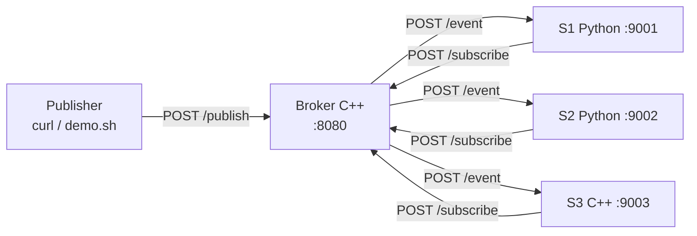
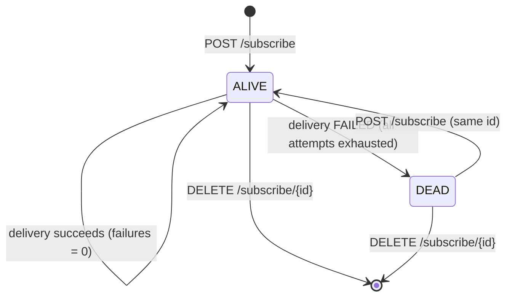

# Spec: Fault-Tolerant Publish–Subscribe Broker over REST

Status: **Approved by user.**
Repo: `TanKaizokuO/fault-tolerant-pubsub-broker`

## 1. Purpose

A Distributed Systems mini-project ("Simple Publish–Subscribe System Using REST Endpoints") that demonstrates, with genuine inter-process HTTP communication:

- subscriber registration and deregistration
- event publishing
- event delivery via HTTP POST callbacks
- unicast, multicast, and broadcast delivery
- subscriber failure detection and recovery

The system must be demonstrable end to end in **≤ 5 minutes** on a single Ubuntu machine.

## 2. Goals and non-goals

**Goals**
- Every component is a separate OS process; all interaction is HTTP + JSON. No shared memory, no shared files.
- C++ carries the core distributed-systems logic (the broker).
- Subscribers in two languages (Python, C++) prove the contract is language-neutral.
- Failure handling is observable: timeouts, retries, `DEAD` marking, recovery on re-registration.
- At-least-once delivery with idempotent subscribers (event-ID deduplication).

**Non-goals** (deliberate; stated in the README as known limitations)
- Broker replication or failover — the broker is a single point of failure.
- Persistence — registry and events are in memory; a broker restart loses state.
- Durable queues or replay of events missed while a subscriber was `DEAD`.
- Heartbeat-based failure detection — failures are detected at delivery time only.
- Multi-machine deployment — all endpoints run on `localhost`.
- Authentication, TLS, ordering guarantees across publishers.

## 3. Architecture



| Component | Language | Libraries | Role |
|---|---|---|---|
| Broker | C++17 | cpp-httplib, nlohmann/json (vendored single headers) | Registry, routing, concurrent fan-out, failure detection, delivery reports |
| `subscriber.py` | Python 3 | standard library only (`http.server`, `urllib`, `json`) | Registers, receives callbacks, deduplicates, logs |
| `subscriber.cpp` | C++17 | cpp-httplib, nlohmann/json | Same contract as the Python subscriber |
| Publisher | shell | `curl` | Sends events; wrapped by `scripts/demo.sh` |

### Distributed-systems concepts demonstrated

| Concept | Where it is visible |
|---|---|
| Independent processes, message passing only | Broker and subscribers are separate processes talking only over HTTP |
| Indirection / loose coupling | Publishers address modes and topics, never subscriber endpoints |
| Heterogeneity | C++ broker serves Python and C++ subscribers through one REST contract |
| Group communication | Unicast, multicast (topic), broadcast |
| Partial failure | One subscriber dies; others keep receiving |
| Timeout-based failure detection | Broker cannot distinguish slow from dead; decides by timeout + retries |
| At-least-once + idempotency | Retries may duplicate; subscribers drop repeated `event_id`s |
| Recovery | A `DEAD` subscriber re-registers and resumes receiving |
| Single point of failure | Broker; discussed as an explicit trade-off |

## 4. Broker REST API

Base URL: `http://localhost:8080`. All bodies are JSON (`Content-Type: application/json`). Errors return `{"error": "<message>"}`.

### 4.1 `POST /subscribe` — register or re-register

Request:
```json
{ "id": "S1", "callback_url": "http://localhost:9001/event", "topics": ["sports"] }
```

| Rule | Behaviour |
|---|---|
| `id` new | Create subscriber, state `ALIVE`, `failures = 0` → `201` |
| `id` exists (any state) | Replace `callback_url` and `topics`, reset to `ALIVE`, `failures = 0` → `200` |
| Missing/invalid `id`, `callback_url`, or `topics` (must be an array of strings; may be empty) | `400` |

Response:
```json
{ "id": "S1", "state": "ALIVE", "topics": ["sports"] }
```

### 4.2 `DELETE /subscribe/{id}` — deregister

`200 {"id": "S1", "removed": true}`; unknown id → `404`.

### 4.3 `POST /publish` — publish an event

Request:
```json
{ "mode": "multicast", "target": "sports", "payload": { "score": "2-1" }, "event_id": "optional" }
```

| `mode` | `target` | Recipients |
|---|---|---|
| `unicast` | subscriber id (required) | That subscriber, if `ALIVE` |
| `multicast` | topic (required) | Every `ALIVE` subscriber whose `topics` contains `target` |
| `broadcast` | ignored | Every `ALIVE` subscriber |

| Rule | Behaviour |
|---|---|
| `mode` missing/unknown, or `target` missing for unicast/multicast | `400` |
| Unicast to unknown id | `404` |
| Unicast to a `DEAD` subscriber | `200`, report entry with status `SKIPPED_DEAD`, no delivery attempted |
| Multicast/broadcast with zero `ALIVE` recipients | `200`, empty `deliveries` |
| `DEAD` subscribers in multicast/broadcast | Not attempted, not listed |
| `event_id` supplied | Used as-is (publisher-side idempotency key; also lets the demo show subscriber dedup) |
| `event_id` omitted | Broker assigns `e-<n>`, a monotonically increasing counter |
| `payload` | Any JSON value; forwarded unchanged |

`/publish` is **synchronous**: it returns after every recipient's delivery has finished (success or exhausted retries), so the report is complete.

Response:
```json
{
  "event_id": "e-7",
  "mode": "multicast",
  "target": "sports",
  "deliveries": [
    { "id": "S1", "status": "DELIVERED", "attempts": 1, "ack": "processed" },
    { "id": "S3", "status": "FAILED", "attempts": 3, "error": "Connection refused" }
  ]
}
```

Delivery `status`: `DELIVERED` | `FAILED` | `SKIPPED_DEAD`. `ack` echoes the subscriber's response status (`processed` or `duplicate`).

### 4.4 `GET /subscribers` — observe broker state

```json
[
  { "id": "S1", "callback_url": "http://localhost:9001/event", "topics": ["sports"],
    "state": "ALIVE", "failures": 0, "delivered": 4 }
]
```

### 4.5 `GET /health`

`200 {"status": "ok"}` — used by scripts to wait for the broker to come up.

## 5. Subscriber contract

### 5.1 Callback: `POST /event`

Body sent by the broker:
```json
{ "event_id": "e-7", "mode": "multicast", "topic": "sports",
  "payload": { "score": "2-1" }, "timestamp": "2026-11-07T10:15:30Z" }
```
`topic` is the multicast target, or `null` for unicast and broadcast. `timestamp` is broker time, ISO 8601 UTC.

Responses:
- First time this `event_id` is seen → log the event, `200 {"status": "processed"}`
- Already seen → log `duplicate ignored`, `200 {"status": "duplicate"}`
- Malformed body → `400`

Deduplication keeps the most recent 1000 `event_id`s in memory (bounded set + FIFO eviction).

### 5.2 Lifecycle

- CLI (both implementations): `--id S1 --port 9001 --topics sports,news --broker http://localhost:8080`
- On startup: start the HTTP server, then `POST /subscribe`, retrying every 1 s for up to 10 s until the broker answers. Exit non-zero if registration never succeeds.
- On exit (Ctrl+C / SIGTERM): **does not deregister**. Exiting is the crash simulation for the failure demo; explicit deregistration is shown with `curl -X DELETE`.
- Callback URL is `http://localhost:<port>/event`.

## 6. Delivery and failure handling (broker)

### 6.1 Fan-out

1. Under the registry mutex, snapshot the recipient list (id + callback URL).
2. Release the mutex; deliver to each recipient on its own thread (`std::async` / `std::thread`), so a slow or dead subscriber never delays the others.
3. Join all threads, then update each subscriber's counters/state under the mutex.
4. Build and return the delivery report.

A subscriber that re-registers or is deleted while a delivery is in flight: the state update is applied only if the subscriber still exists **and** its callback URL is unchanged; otherwise the result is reported but not applied.

### 6.2 Per-recipient delivery

| Parameter | Value |
|---|---|
| Connect timeout | 1 s |
| Read/write timeout | 2 s |
| Max attempts per delivery | 3 |
| Backoff between attempts | 200 ms, then 400 ms |
| Success | HTTP `2xx` |
| Retryable failure | Connection error, timeout, HTTP `5xx` |
| Non-retryable failure | HTTP `4xx` → `FAILED` after 1 attempt |

### 6.3 State transitions



A single delivery that exhausts all 3 attempts marks the subscriber `DEAD` (the retries already provide the tolerance window). `failures` counts total failed deliveries, for observability. `DEAD` subscribers are skipped by multicast/broadcast and reported as `SKIPPED_DEAD` for unicast.

### 6.4 Delivery semantics

**At-least-once** while the subscriber is `ALIVE`: a retry after a lost response can deliver the same event twice; subscribers deduplicate by `event_id`. Events published while a subscriber is `DEAD` are **not** delivered later (no replay).

## 7. Logging

Every process logs one line per significant action to stdout:

```
[10:15:30.123] [broker] REGISTER S1 topics=[sports] -> http://localhost:9001/event
[10:15:31.456] [broker] PUBLISH e-7 multicast target=sports recipients=[S1,S3]
[10:15:31.460] [broker] DELIVER e-7 -> S3 attempt 1 failed: Connection refused
[10:15:32.070] [broker] MARK DEAD S3 after 3 attempts
[10:15:31.458] [S1] EVENT e-7 multicast topic=sports payload={"score":"2-1"}
[10:15:40.001] [S1] DUPLICATE e-7 ignored
```

## 8. Repository layout

```
.
├── CMakeLists.txt              # builds broker, cpp subscriber, broker unit tests
├── broker/
│   ├── main.cpp                # CLI, HTTP routes
│   ├── registry.hpp/.cpp       # subscriber registry + routing (pure logic, unit-tested)
│   └── delivery.hpp/.cpp       # HTTP callback with timeout/retry
├── subscribers/
│   ├── subscriber.py
│   └── subscriber.cpp
├── third_party/
│   ├── httplib.h               # cpp-httplib, pinned release
│   ├── json.hpp                # nlohmann/json, pinned release
│   └── VERSIONS                # pinned versions + source URLs
├── tests/
│   ├── registry_test.cpp       # C++ unit tests (plain asserts, run via ctest)
│   └── test_integration.py     # spawns real processes; stdlib unittest
├── scripts/
│   ├── run_all.sh              # tmux layout: broker + S1, S2, S3 + publisher pane
│   └── demo.sh                 # scripted 5-minute demo, pauses between steps
├── docs/
│   └── spec.md                 # this file
├── AGENTS.md
└── README.md
```

## 9. Build and run (Ubuntu 22.04+)

Prerequisites: `sudo apt install g++ cmake python3 tmux curl`

```bash
cmake -S . -B build && cmake --build build -j
./build/broker --port 8080
python3 subscribers/subscriber.py --id S1 --port 9001 --topics sports
./build/subscriber --id S3 --port 9003 --topics sports
```

Debug build with sanitizers: `cmake -S . -B build -DSANITIZE=ON` (`-fsanitize=address,undefined`).

## 10. Demo script (≤ 5 minutes)

`scripts/run_all.sh` opens tmux panes; `scripts/demo.sh` runs the steps, pausing for Enter between them.

| # | Action | Expected observation |
|---|---|---|
| 1 | Start broker; S1 (Py, `sports`), S2 (Py, `news`), S3 (C++, `sports`) | Three `REGISTER` lines in broker log |
| 2 | Unicast to S2 | Only S2 logs the event; report has 1 `DELIVERED` |
| 3 | Multicast to `sports` | S1 and S3 log; S2 silent |
| 4 | Broadcast | All three log |
| 5 | Publish again with an explicit, already-used `event_id` | Subscribers log `DUPLICATE … ignored`; report `ack: duplicate` |
| 6 | Kill S2 (Ctrl+C), broadcast | Broker logs 3 failed attempts and `MARK DEAD S2`; report: S1, S3 `DELIVERED`, S2 `FAILED` |
| 7 | `GET /subscribers` | S2 `DEAD`, `failures: 1` |
| 8 | Broadcast again | S2 not attempted; S1, S3 receive |
| 9 | Restart S2 | Re-registers; state `ALIVE` |
| 10 | Broadcast | All three receive |
| 11 | `DELETE /subscribe/S3`, broadcast | S3 no longer receives |

## 11. Testing

- **C++ unit tests** (`tests/registry_test.cpp`): registration/re-registration rules, recipient selection per mode, `DEAD` exclusion, unknown-id handling, state updates guarded against concurrent re-registration.
- **Integration tests** (`tests/test_integration.py`, stdlib `unittest`): start the real broker binary and real subscriber processes on free ports; verify each row of §10 through HTTP and subscriber output, including killing a subscriber process.
- Run: `ctest --test-dir build && python3 -m unittest discover tests`.

## 12. Acceptance criteria

- [ ] `cmake` build succeeds on a clean Ubuntu 22.04+ with only the §9 prerequisites.
- [ ] All endpoints in §4 and §5 behave as specified, including error codes.
- [ ] Unicast, multicast, and broadcast reach exactly the specified recipients.
- [ ] A killed subscriber is marked `DEAD` after one failed delivery (3 attempts) and does not delay delivery to other subscribers beyond the per-attempt timeouts.
- [ ] A `DEAD` subscriber recovers by re-registering.
- [ ] Duplicate `event_id`s are acknowledged as `duplicate` and not re-processed.
- [ ] Python and C++ subscribers are interchangeable against the same broker.
- [ ] Unit and integration tests pass; no sanitizer errors in the `SANITIZE=ON` build.
- [ ] `scripts/demo.sh` completes all §10 steps within 5 minutes.
- [ ] README covers purpose, architecture, build, run, demo, and §2 limitations.
